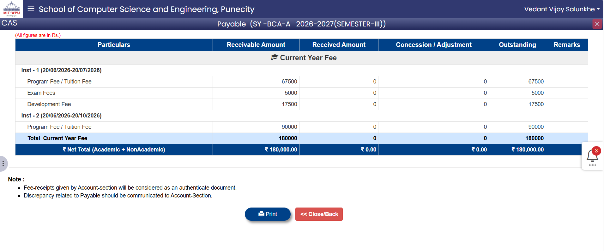

# MyelinSheets

> **Neuromarketing Framework** — where neuroscience meets brand strategy.

MyelinSheets is an interactive, high-performance marketing website built with **Next.js 15**, **Three.js / React Three Fiber**, **GSAP**, and **Tailwind CSS v4**. It features an interactive 3D brain model that responds to scroll and pointer, smooth inertia scrolling, floating brand logos, and a modern glassmorphism design.

The brand translates published neuromarketing research into strategic decisions — measuring how the brain (not the rational mind) drives 95% of purchase decisions.

---

## ✨ Features

- **Interactive 3D Brain** — A photorealistic GLTF brain model rendered with React Three Fiber that reacts to scroll position, pointer movement, and breathing animation.
- **Smooth Inertia Scrolling** — Lenis-powered buttery smooth scrolling, synced with GSAP's ticker.
- **Floating Brand Logos** — Animated brand logos (Coca-Cola, Pepsi, Lay's, Google, Amul, Fevicol, etc.) that drift through the side corridors of the viewport and link to their case studies.
- **Glassmorphism UI** — Frosted-glass cards, backdrops, and gradient surfaces throughout.
- **GSAP Scroll Animations** — Neuron artwork parallax, floating logo relocation, and scroll-triggered 3D transforms.
- **Fully Responsive** — Optimized layouts, mobile 3D rendering, and adapted floating-logo behavior across breakpoints.
- **Dynamic Case Studies** — 13 published neuromarketing case studies with static generation and client-side filtering.
- **Reduced-Motion Support** — Respects `prefers-reduced-motion` for accessibility.

---

## 🚀 Tech Stack

| Category | Technology |
| :--- | :--- |
| **Framework** | [Next.js 15](https://nextjs.org/) (App Router) |
| **Language** | [TypeScript](https://www.typescriptlang.org/) |
| **3D Graphics** | [Three.js](https://threejs.org/) + [@react-three/fiber](https://r3f.docs.pmnd.rs/) & [@react-three/drei](https://drei.docs.pmnd.rs/) |
| **Animations** | [GSAP](https://gsap.com/) & `@gsap/react` |
| **Smooth Scroll** | [Lenis](https://lenis.darkroom.engineering/) |
| **Styling** | [Tailwind CSS v4](https://tailwindcss.com/) + PostCSS |
| **Font** | [Plus Jakarta Sans](https://fonts.google.com/specimen/Plus+Jakarta+Sans) via `next/font` |

---

## 📁 Project Structure

```text
.
├── public/
│   ├── assets/                 # Icons, neural-web artwork, neuron imagery
│   ├── logos/                  # Brand logos (Coca-Cola, Pepsi, Amul, etc.)
│   └── models/                 # 3D brain GLTF models
├── src/
│   ├── app/
│   │   ├── about/              # About page
│   │   ├── case-studies/       # Case studies grid
│   │   │   └── [slug]/         # Dynamic case study detail page
│   │   ├── contact/            # Contact / discovery call page
│   │   ├── industries/         # Industries page
│   │   ├── services/           # Services page
│   │   ├── globals.css         # Global styles (Tailwind v4, Lenis, animations)
│   │   ├── layout.tsx          # Root layout (fonts, smooth scroll, floating logos)
│   │   └── page.tsx            # Home page
│   ├── components/
│   │   ├── BrainCanvas.tsx     # 3D brain canvas (scroll/pointer-reactive)
│   │   ├── BrainMesh.tsx       # Secondary brain mesh material logic
│   │   ├── CaseStudiesContent.tsx # Case studies grid + filters
│   │   ├── ClientFloatingLogos.tsx # Client wrapper for floating logos
│   │   ├── FloatingLogos.tsx   # Animated floating brand logos
│   │   ├── MainContent.tsx     # Home page main content
│   │   ├── SiteShell.tsx       # Global nav, footer, backdrop
│   │   └── SmoothScroll.tsx    # Lenis smooth scroll integration
│   └── data/
│       ├── caseStudies.ts      # 13 published neuromarketing case studies
│       └── siteContent.ts      # Services, industries, principles, research tools
├── postcss.config.mjs          # PostCSS configuration for Tailwind v4
├── tsconfig.json               # TypeScript configuration
└── package.json                # Project dependencies & scripts
```

---

## 🛠️ Getting Started

### Prerequisites

- **Node.js 18+** (recommended: Node.js 20+)
- npm (or your preferred package manager)

### Installation

1. **Clone the repository:**

   ```bash
   git clone https://github.com/varaddongare-dev/Myliensheets-Webpage-v0.2.1.git
   cd Myliensheets-Webpage-v0.2.1
   ```

2. **Install dependencies:**

   ```bash
   npm install
   ```

3. **Run the development server:**

   ```bash
   npm run dev
   ```

4. **Open in your browser:**

   Navigate to [http://localhost:3000](http://localhost:3000) to view the app.

### Available Scripts

| Command | Description |
| :--- | :--- |
| `npm run dev` | Starts the Next.js development server |
| `npm run build` | Builds the application for production |
| `npm start` | Starts the production server |
| `npm run lint` | Runs ESLint to check for lint errors |

---

## 📄 Pages & Routes

| Route | Description |
| :--- | :--- |
| `/` | Home — hero, stats, services, science comparison, CTA |
| `/services` | Six neuromarketing services, process, research tools & principles |
| `/case-studies` | Filterable grid of 13 published case studies |
| `/case-studies/[slug]` | Detailed view of an individual case study (static generated) |
| `/industries` | Industry applications (FMCG, Retail, Fintech, Healthcare, Auto, B2B, etc.) |
| `/about` | Brand story, manifesto, and values |
| `/contact` | Book a discovery call form |

---

## 🧠 Content Data

All website content is centralized in `src/data/` for easy editing:

- **`src/data/siteContent.ts`** — Services, service steps, research tools (EEG, Eye-Tracking, Behavioral Data), principles, industries, about values, and manifesto paragraphs.
- **`src/data/caseStudies.ts`** — 13 published neuromarketing case studies (Coca-Cola, Pepsi, Lay's, Google, Campbell's, Hyundai, Mercedes-Benz, PayPal, Amul, Fevicol, Tata Tea, Cadbury, Tanishq), each with brand, stat, headline, study body, insight, tool, year, and market.

---

## 🖼️ Screenshot



---

## 🤝 Contact

- **Email:** [info@myelinsheets.com](mailto:info@myelinsheets.com)
- **Website:** [www.myelinsheets.com](https://www.myelinsheets.com)

---

## 📜 License

This project is a private, proprietary project. All rights reserved. © 2026 MyelinSheets.
